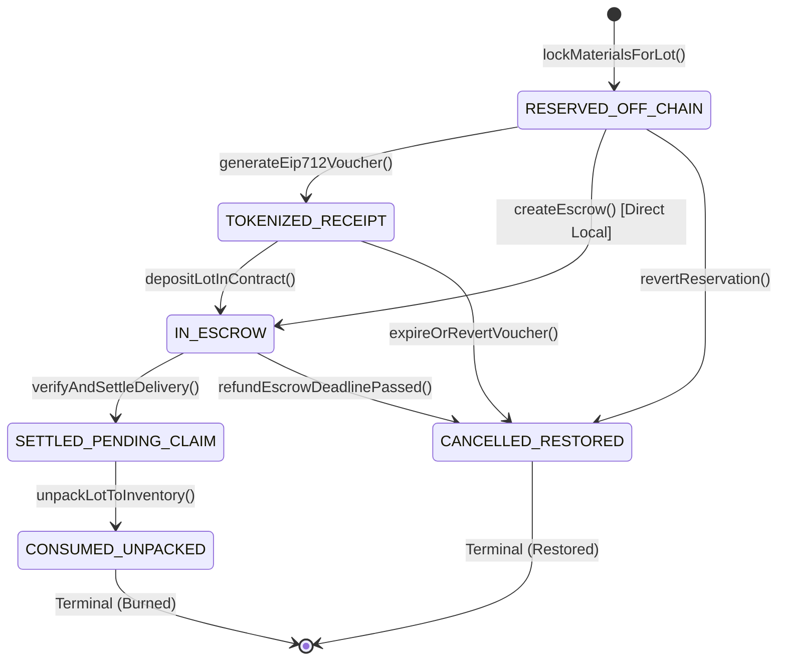
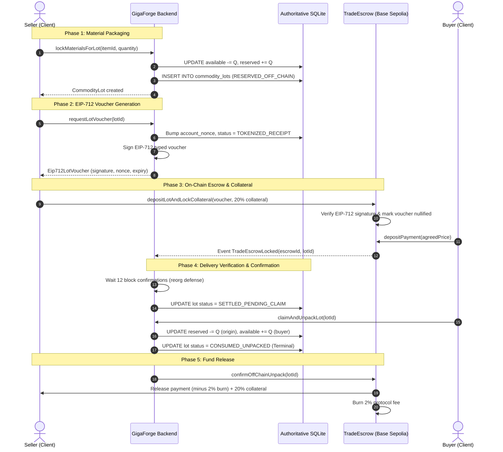

# Web3 Testnet Flow Specification: NFTs, Rentals, and Settlement

Lead with the answer: **GigaForge v4.1 preserves a strictly off-chain high-frequency simulation engine while enabling Web3 testnet interoperability for digital property rights, rental licensing (ERC-4907), and B2B trade settlement (ERC-1155) through EIP-712 vouchers, without placing the internal game loop on-chain.**

---

## 1. Architectural Scope & Boundary

The system maintains a rigid partition between off-chain game execution and on-chain asset custody.

```
+------------------------------------------------------------------------+
|                      OFF-CHAIN ENGINE & SIMULATION                     |
|                                                                        |
|  * 2,700 Ticks / Match (Mulberry32 PRNG determinism)                   |
|  * Production Lines, Energy Grid, Maintenance Billing                  |
|  * Internal Credit Ledger & Local SQLite Storage                       |
|  * MCP AI Agent Automation (ReadOnly / ReadWrite Grants)               |
+-----------------------------------+------------------------------------+
                                    |
                    EIP-712 Cryptographic Vouchers
                    Authoritative SQLite Two-Phase Lock
                                    |
+-----------------------------------v------------------------------------+
|                         ON-CHAIN TESTNET LAYER                         |
|                         (Base Sepolia - L2 EVM)                        |
|                                                                        |
|  * Facility Deeds (ERC-721): Unique physical properties                |
|  * Blueprint Modifiers (ERC-4907): Dual-role rental licensing          |
|  * Commodity Lot Receipts (ERC-1155): Wholesale resource packaging     |
|  * TradeEscrow Contract: 20% collateral, 2% protocol fee burn          |
+------------------------------------------------------------------------+
```

### What is Tokenized vs. What Remains Off-Chain

| Dimension | Tokenized (On-Chain / Testnet) | Off-Chain (Simulation & SQLite) |
|---|---|---|
| **Simulation Ticks** | Never tokenized. Block times (2s) cannot sync with millisecond tick loops. | Authoritative game engine loop. |
| **Raw Resources** | Never tokenized individually (e.g., individual ore units or energy discrete values). | Factory inventories (`inventory.available`). |
| **Wholesale Batches** | Packed into `CommodityLot` -> `LotReceipt` (ERC-1155). | Reserved in `inventory.reserved` while active. |
| **Equipment & Deeds** | `FacilityDeed` (ERC-721) for rare infrastructure. | Factory machine instances and slot layouts. |
| **Technological Rights** | `BlueprintModifier` (ERC-4907) with time-bound rental roles. | Recipe definitions and runtime efficiency calculations. |
| **Currency & Balances** | Testnet settlement tokens or mock stablecoins in external escrows. | In-game `credits` for tick-by-tick operational expenses. |
| **AI Agent Commands** | Zero on-chain presence. No tool signs transactions. | Scoped MCP tool calls (`set_production_target`, etc.). |

---

## 2. Core Material & Ownership Invariants

### Invariant 1: Material Conservation (No Double-Counting / No Double-Spending)

An inventory item (e.g., `STEEL_PLATE`, `IND_TURBINE`) in a factory can **never** be simultaneously available for factory recipes and packed into an active commercial lot.

$$\text{TotalStock}(\text{company}, \text{item}) = \text{Stock}_{\text{available}} + \text{Stock}_{\text{reserved}}$$

$$\text{Stock}_{\text{reserved}} = \sum_{\text{active lots}} \text{Lot}.\text{quantity}$$

- Moving materials to a lot deducts from `available` and adds to `reserved` in a single atomic transaction (`runAtomic`).
- Unpacking a settled lot credits `available` for the buyer and clears `reserved` for the seller.
- Cancelling a reservation restores `available` for the seller and clears `reserved`.

### Invariant 2: Ownership vs. Usage Rights Separation (ERC-4907 Rentals)

Game mechanics requiring specialized blueprints or high-tier facility capabilities check **Usage Rights** (`UsageRight`), not raw wallet ownership (`Ownership`).

```typescript
export interface UsageRight {
  readonly usageId: string;
  readonly assetId: string;
  readonly beneficiaryCompanyId: string;
  readonly validFromTick: number;
  readonly expiresAtTick: number; // Deterministic expiration
  readonly revenueShareBps: number; // Guild sharing e.g. 1000 = 10%
  readonly isActive: boolean;
}
```

- **Owner**: Holds the NFT in their wallet (or custody contract). Can transfer, sell, or grant rental rights.
- **User (Lessee)**: Granted time-limited right to use the asset via ERC-4907 `setUser(tokenId, user, expires)`.
- **Engine Verification**: At tick $T$, the engine verifies:
  $$\text{CanProduce}(\text{recipe}) \iff \exists \text{UsageRight} : \text{beneficiary} = \text{company} \land T \in [\text{validFromTick}, \text{expiresAtTick}]$$
  When $T > \text{expiresAtTick}$, the permission expires automatically with zero transaction overhead.

---

## 3. State Machines & Lifecycle Event Flows

### CommodityLot State Machine



### TradeEscrow Settlement Lifecycle



---

## 4. Protection Architecture

### 4.1 Double-Spending Defense

- **Off-Chain Isolation**: SQLite executes all material locks inside `runAtomic` with unique reservation constraints. A company cannot reserve more stock than is strictly available in `inventories.available_qty`.
- **EIP-712 Anti-Replay Nonces**: Each company has an incremental nonce stored in `account_nonces`. Generating a voucher increments the nonce immediately in SQLite.
- **On-Chain Nullifier Registry**: The `TradeEscrow1155` smart contract stores:
  ```solidity
  mapping(bytes32 => bool) public redeemedVouchers;
  
  function depositLot(Eip712LotVoucher calldata v) external {
      bytes32 voucherHash = _hashLotVoucher(v);
      require(!redeemedVouchers[voucherHash], "ERR_VOUCHER_ALREADY_USED");
      redeemedVouchers[voucherHash] = true;
      // ...
  }
  ```
  Once submitted on-chain, the voucher hash is nullified forever.

### 4.2 Blockchain Reorganization (Reorg) Defense

- **Confirmation Depth ($N = 12$)**: On Base Sepolia (OP Stack rollup), soft block times are 2 seconds. The settlement adapter does not emit `SETTLED_PENDING_CLAIM` or credit buyer inventory until the transaction is **12 blocks deep** (~24 seconds).
- **Reorg Reconciliation Handler**:
  1. The backend tracks the transaction hash and block number in `match_settlement_reorg_tracker`.
  2. If an L2 sequencer reorg occurs and the transaction receipt is evicted from the canonical chain, the settlement engine halts the unpack operation.
  3. The escrow transitions to `DISPUTED` instead of double-crediting materials.

### 4.3 Repeated Settlement & Replay Protection

- **Idempotent Transitions**: If an unpack command is sent twice with the same `lotId`, the second invocation is rejected by `validateLotTransition` because `CONSUMED_UNPACKED` is a terminal state with no outbound transitions.
- **Database Unique Constraints**: `UNIQUE(match_id, tick)` on snapshots and `PRIMARY KEY (lot_id)` prevent row duplications.

### 4.4 Provider Disconnection & RPC Fault Tolerance

- **Circuit Breaker (`reconcileLedgerState()`)**:
  - Periodically compares total materials in `inventory.reserved` against active lots:
    $$\sum \text{Active Lots}.\text{quantity} \stackrel{?}{=} \sum \text{inventory.reserved}$$
  - If a discrepancy $> 0$ is detected (e.g., an RPC desync or interrupted unpack), the circuit breaker **trips**.
  - All lot creations, voucher emissions, and escrow claims are frozen instantly, while the main factory simulation continues running uninterrupted.
- **Graceful RPC Degradation**:
  - Primary RPC: Alchemy / Infura Base Sepolia endpoint.
  - Secondary RPC: Public Base Sepolia endpoint.
  - Fallback: Local offline mock adapter (`SqliteLocalSettlementProvider`). Simulation never halts due to external network outages.

---

## 5. Explicit Credential Separation: MCP AI Agents vs. Web3 Wallets

A critical security principle of GigaForge is the absolute isolation between AI agent runtime permissions and cryptographic asset signing.

```
+------------------------------------------------------------------------+
|                          CREDENTIAL ISOLATION                          |
+------------------------------------+-----------------------------------+
|     MCP AI Agent Architecture      |     Web3 Wallet Architecture      |
+------------------------------------+-----------------------------------+
| * Token: Secret hash (SHA-256) in  | * Key: ECDSA private key held by  |
|   `mcp_grants` table.              |   human player in browser/wallet. |
| * Scopes: `PHASE_1A_READ_ONLY`,    | * Scope: On-chain smart contract  |
|   `PHASE_1B_READ_WRITE`.           |   transfers, deposits, approvals. |
| * Allowed tools:                   | * Signed data: EIP-712 structured |
|   - `get_inventory`                |   messages and EVM transactions.  |
|   - `set_production_target`        | * Security boundary:              |
|   - `draft_supply_offer`           |   ZERO MCP tools have access to   |
| * Security boundary:               |   wallet keys or signing APIs.    |
|   NO MCP TOOL SIGNS WEB3 TXS.      |   Wallets sign client-side.       |
+------------------------------------+-----------------------------------+
```

1. **AI Agents Direct Factory Operations Only**: MCP tools control production targets, line priorities, and off-chain draft offers. They have no visibility into private keys or wallet seeds.
2. **Backend as Oracle / Co-Signer**: When a player wants to tokenize a lot, the backend verifies SQLite inventory and issues an EIP-712 voucher. The backend signs only that *materials are locked*, never the transfer of funds.
3. **Player Authorizes Capital**: The human player (or their ERC-4337 smart wallet session key with strict gas limits) signs the actual on-chain transaction depositing collateral or purchasing lots.

---

## 6. Economic Token & Game Balance Risks

### 6.1 Pay-to-Win (P2W) Mitigation

- **Lateral Specialization over Vertical Dominance**: Tokenized blueprints offer alternative recipe paths (e.g., higher silicon yield for higher energy consumption) rather than raw overpowered multipliers.
- **Megamachine Contribution Caps**: Victory conditions (Megamachine construction) require balanced contributions across all industrial tiers. Wealthy players cannot bypass tier dependencies by simply buying high-tier materials on-chain; factory infrastructure must exist to support turbine installation and energy delivery.

### 6.2 Botting & Sybil Attack Defenses

- **Factory Maintenance Drain**: Idle bot accounts holding resources face recurring energy and credit maintenance bills every 300 ticks. Accounts that cannot cover bills have lines paused and assets flagged.
- **Contract Collateral (20%)**: Posting fake or spam market offers requires locking 20% collateral in credits or tokens, punishing griefing attacks.
- **MCP Rate Limits & Cooldowns**: Issue #15 enforces persistent 5-tick line cooldowns and per-minute invocation limits on MCP tools, preventing bot swarms from overwhelming market order books.

### 6.3 Regulatory & Compliance Boundaries

- **Utility Token Classification**: Tokens represent digital warehouse receipts for in-game goods consumed and destroyed during production.
- **No Staking Yield / No Financial Promises**: The game provides zero passive yield, staking rewards, or promises of monetary returns.
- **Testnet-Only Scope**: This implementation operates strictly on testnets (Base Sepolia) with zero real-world monetary value, no ICOs, and no private sales.
